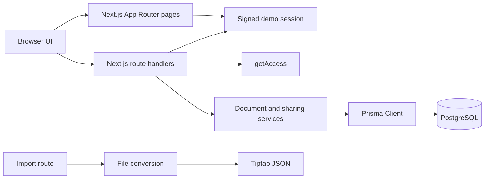

# Architecture

## Overview

## Persistence

`prisma/schema.prisma` defines three models:

- `User`: unique email and display name.
- `Document`: owner relation, title, JSON content, and timestamps.
- `DocumentShare`: user/document join with `viewer` or `editor` role and a composite primary key that prevents duplicate shares.

The Prisma datasource reads `DATABASE_URL`. `src/lib/prisma.ts` reuses a development client across hot reloads.

## Authentication and Authorization

`src/lib/session.ts` creates a seven-day HMAC-signed cookie using `SESSION_SECRET`. The cookie is `httpOnly`, `sameSite=lax`, scoped to `/`, and `secure` in production. The login page intentionally lets reviewers choose a seeded user without a password; this is demo-only authentication.

`src/lib/access.ts` is the authorization decision function. It resolves a caller to `owner`, `editor`, `viewer`, or `none`. Document endpoints require a session and use this decision for each document. A caller with no access receives 404 to avoid disclosing document existence. A viewer who attempts an update gets 403. Sharing operations require ownership; a collaborator gets 403, while a caller with no access gets 404.

The public login endpoint is the intentional exception to session-required routes. Logout requires an active session. Route errors use `{ error: { code, message } }`; malformed input is validated with Zod, and unexpected server/database failures use 500 responses.

## Request Flows

### Documents

`GET /api/documents` returns owned and shared documents with a caller-specific `access` value. `POST /api/documents` creates an empty Tiptap document. `GET`, `PATCH`, and `DELETE /api/documents/[id]` provide detail and mutation operations. Titles are limited to 200 characters. JSON request bodies are limited to 1 MB by `src/lib/api.ts`.

### Sharing

`src/lib/sharing.ts` contains the service operations without HTTP concerns. It checks the owner, resolves collaborators by existing email, prevents sharing with the owner, upserts roles, removes shares, and lists collaborators. The route at `/api/documents/[id]/share` performs session, owner, and Zod checks, then maps service failures to HTTP responses.

### Import

`POST /api/documents/import` accepts multipart form data in the `file` field and runs in the Node.js runtime. It accepts `.txt`, `.md`, and `.docx` files up to 2 MB, rejects empty files, and checks the DOCX `PK` ZIP signature.

`src/lib/import/convert.ts` converts plain text to escaped paragraph HTML, Markdown through markdown-it, and DOCX through Mammoth. The resulting HTML is converted to Tiptap JSON with `generateJSON` and the same extension array used by the editor in `src/lib/editor-extensions.ts`. The route creates a new document for the current user using `src/lib/documents.ts`; the filename without its extension becomes the title.

## UI

The dashboard fetches document lists, separates owned and shared views, offers creation and import, and reports loading/error states. The editor uses Tiptap with `immediatelyRender: false`, disables editing for viewers, saves titles on blur, and debounces content updates. Pending edits trigger a browser leave warning. Owners can open the sharing dialog to add collaborators, change roles, or remove access.

App and editor loading boundaries render skeletons. App-level `error.tsx` and `not-found.tsx` provide retry and recovery navigation.

## Tests

Vitest runs unit tests for `getAccess` and file conversion, plus service/route tests using an in-memory mocked Prisma API. The sharing tests exercise viewer reads, viewer PATCH rejection, editor PATCH success, revocation, owner restrictions, and unknown/self-sharing errors. Auth route tests cover malformed login, required logout session, and a database failure response.

The GitHub Actions workflow runs `npm ci`, Prisma Client generation, lint, tests, and TypeScript validation.

## Current Limitations

- Authentication is a seeded-user picker with no passwords or external identity provider.
- Sharing is limited to existing seeded/registered users; there are no invitations or share links.
- Import supports text, Markdown, and DOCX only. Images and complex Word layouts are not imported.
- There is no concurrent-edit conflict resolution or document version history.
- The current `npm run build` script applies deployed migrations and runs the demo seed before building. For production, separate these steps and decide whether demo records should be seeded at all.